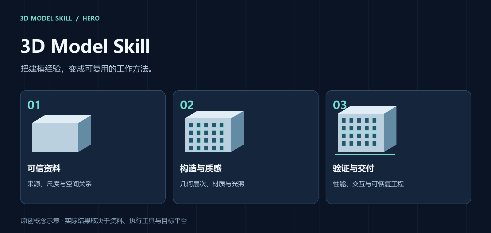
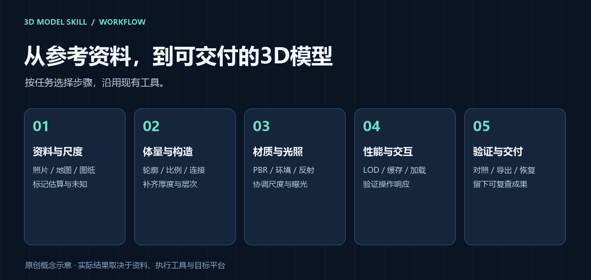
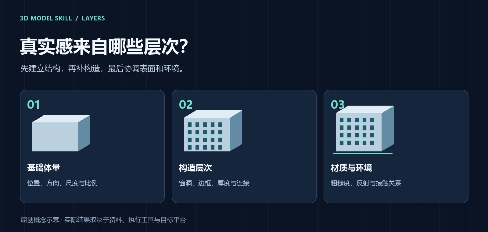

<div align="center">



# 3D Model Skill

### 把建模经验，变成可复用的工作方法。

照片、地图、图纸与现有模型 → **3D Model Skill** → 可编辑模型、交互场景与验证记录


[](https://github.com/chchaiai/3D-Model-Skill/stargazers)

[适用场景](#适用场景) · [工作流程](#工作流程) · [可视化理解](#可视化理解) · [安装](#安装) · [使用](#使用) · [交付与验证](#交付与验证)

</div>

---

想根据照片建立模型，却缺少可靠尺寸？已有场景看起来像积木？材质变精细后，加载和拖动开始变慢？

这个技能将资料判断、几何细化、材质光照、性能优化和验收整理成统一工作方法，帮助 Agent 根据目标和现有项目推进任务。

## 适用场景

| 🏗️ 从资料建立模型 | 🧱 优化现有模型 | 🗺️ 完成交互场景 |
| --- | --- | --- |
| 建筑、校园、园区与一般物体 | 玻璃、墙面、屋顶、水面与局部构造 | 三维地图、对象选取、搜索与定位 |
| 确定尺度、比例、轮廓和空间关系 | 对照参考补层次，协调PBR材质与光照 | 优化LOD、加载顺序、缓存与操作响应 |
| 保留来源，标记估算与未知 | 保存基线，让改动可比较、可回退 | 在目标环境检查功能和性能 |

沿用项目已有的建模工具、渲染器和输出格式。实际执行需要所在环境具备相应软件与权限。

## 工作流程



| 阶段 | 关键判断 | 可检查的结果 |
| --- | --- | --- |
| **资料与尺度** | 哪些已确认，哪些属于估算？ | 来源、日期、单位与尺寸依据 |
| **体量与构造** | 位置、比例、厚度与连接是否合理？ | 基础模型、局部候选与参考对照 |
| **材质与光照** | 表面尺度、反射与环境是否一致？ | 材质预设和关键视角渲染 |
| **性能与交互** | 目标设备能否顺畅加载和操作？ | LOD、资源策略与实测记录 |
| **验证与交付** | 文件能否编辑、运行和恢复？ | 导出资源、版本与验证说明 |

按任务选择需要的步骤。一次局部材质优化，可以直接从现有模型与关键视角开始。

## 可视化理解



**改善“积木感”时，优先检查构造与进深。** 窗洞侧壁、窗框厚度、屋顶收边和接触关系会影响真实感；材质与反射需要在这些基础上协调。

以上图片为原创流程和概念示意。实际建模效果取决于参考资料、模型复杂度、执行工具及目标平台。

## 安装

### 让 Agent 安装

将下面这句话发送给具备技能安装能力的 Agent：

```text
从 https://github.com/chchaiai/3D-Model-Skill 安装技能，目录名使用 3d-model-skill，并检查安装结果。
```

### 手动安装到 Codex

将仓库克隆到 Codex 的技能目录。若设置了 CODEX_HOME，请使用该目录下的 skills 文件夹。

**Windows PowerShell**

```powershell
git clone https://github.com/chchaiai/3D-Model-Skill.git "$env:USERPROFILE\.codex\skills\3d-model-skill"
```

**macOS / Linux**

```bash
git clone https://github.com/chchaiai/3D-Model-Skill.git ~/.codex/skills/3d-model-skill
```

安装后新开 Codex 对话，调用 `$3d-model-skill`。若技能未显示，重启 Codex 后再检查。

## 使用

### 🏗️ 根据资料建立模型

```text
使用 $3d-model-skill，根据附带照片、平面图和尺寸建立建筑模型。
优先保证位置与比例，标记估算部分，输出可编辑源文件与GLB。
```

### ✨ 改善现有场景的真实感

```text
使用 $3d-model-skill，优化当前模型的玻璃、墙面、屋顶和水面。
保留建筑布局，对照参考补充构造层次，协调材质、光照与反射。
```

### ⚡ 优化加载与操作

```text
使用 $3d-model-skill，缩短三维地图首次可操作时间。
检查LOD、贴图、绘制次数和缓存，验证目标手机上的拖动与缩放。
```

提供 **目标对象 + 现有资料或项目 + 输出格式 + 目标设备**，可帮助 Agent 更快确定工作范围。

## 交付与验证

| 你得到什么 | 如何检查 |
| --- | --- |
| **模型与必要资源** | 在目标应用打开，检查几何、材质、导出和对象关系 |
| **关键视角对照** | 对照参考与修改前画面，确认比例和细节 |
| **性能与功能记录** | 写明设备、分辨率、画质、网络、缓存和操作条件 |
| **来源与不确定项** | 区分已确认、估算和待补资料 |
| **可恢复工程（按需求）** | 独立解压，核验资源并验证启动方式 |

桌面浏览器、模拟器和实体设备分别记录验证范围。静帧导出对应图片质量，连续操作实测对应交互性能。

<details>
<summary><b>查看仓库结构</b></summary>

```text
3D-Model-Skill/
├── SKILL.md              # Agent执行说明
├── agents/openai.yaml    # Codex显示名称与调用配置
├── docs/images/          # README原创可视化
└── README.md             # 安装、使用与能力说明
```

</details>

完整执行说明见 [SKILL.md](SKILL.md)。仓库提供技能说明与文档插图；模型、照片和第三方材质的许可由具体项目核对。

---

<div align="center">

[阅读技能](SKILL.md) · [提交问题](https://github.com/chchaiai/3D-Model-Skill/issues)

</div>
